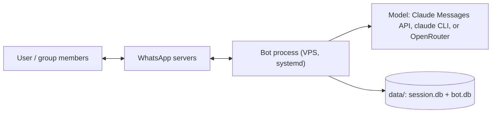

# wagoya

How the system is built. `DECISIONS.md` overrules this file wherever they disagree. Cite decision codes (`B2`) instead of restating the choice or its reason.



## A. Purpose and scope

A WhatsApp number backed by Claude that the user can DM and add to groups (A1).

**Goals**
- Reply in groups when anyone @mentions the bot or replies to it (B1, B3), using recent group messages and stored memories as context (B2, B5).
- Reply to whitelisted DMs and deny everyone else without calling Claude (B4, B7).
- Stay only in groups added by, and containing, a whitelisted member (B15).
- Run unattended on the VPS (A4, C1).
- Play one global persona that only whitelisted users can change, and remember people by LID across chats (D1-D4).

**Non-goals**
- Generating media or files (B8). Tools that act on the VPS from chat input.

## B. Context

| Actor / external system | Direction | Interface |
|---|---|---|
| Whitelisted users | both | WhatsApp DM and groups, identified by LID (B9) |
| Other group members | in (context, triggers), out (replies) | WhatsApp groups |
| WhatsApp servers | both | Linked-device protocol via whatsmeow (A2) |
| Model | out | `anthropic-sdk-go` Messages API, or `claude -p` headless with no tools (A5, A7), or OpenRouter chat completions over `net/http` (G1, G2) |

## C. Components

| Component | Code | Responsibility | Owns |
|---|---|---|---|
| Connection | `main.go` | Link (B10), connect, LID resolution (B9), group membership rules (B15), send replies | `data/session.db` |
| Router | `internal/router` | Pure logic: reply/store/deny decision (B1, B3, B4, B7), handles P1..Pn (D4), prompt building with tag neutralising (B9), system prompt with persona (B8, D1), hidden-tag parsing (B12, D2, D4), 128k fitting with a learned bytes-per-token ratio and per-line/request caps (B17, J5) | — |
| Store | `internal/store` | Last 32 messages per chat (B5, B11); per-chat memories with FTS5 (B12, B16); persona with history (D1); global people profiles and facts (D3) | `data/bot.db` |
| Rate limits | `internal/ratelimit` | Global 3 s message pacing with queue (B18); per-chat denial cooldown (B14) | in-memory |
| LLM | `internal/llm` | One stateless request, text + optional image (B6, B8); refusals passed through (B13) | `data/claude-work/` (CLI cwd) |
| Config | `internal/config` | `.env` loading and validation | — |
| Claude Code tasks | `claudetasks.go`, `internal/memtools/claude.go`, `cmd/claude-runner` | Owner-only task queue (O1); `wagoya task claim/status/done` for the laptop runner over SSH (O2); announcing results with the fixed markers (O5). The runner runs Claude Code in a worktree on `claude/task-N` and pushes only that branch on request (O3) | `data/bot.db` `claude_tasks`; laptop worktrees |

Each triggered request runs in its own goroutine, serialised per chat.

## D. Key flows

**Group message, not triggered**: stored in the chat window (B2). No reply.

**Group message that @mentions the bot or replies to it** (any member, B3)
1. Load the chat window, store the message, search memories with the prompt text (top 8).
2. Download the image if the message has one (B8).
3. Assign handles P1..Pn (requester is P1). API mode: show each person's fact count and give the model a `search_facts` tool (FTS5 over every known person, by handle, name or fact text); CLI mode: put all their facts inline (D7). Build the prompt: `<people>`, `<memories>`, `<transcript>`, `<request>`; whitelisted senders are marked by LID/number, not name. The system prompt carries the current persona.
4. Call Claude. With an API provider, memory is written through the tools in `internal/memtools` (J3): `save_fact(subject, content, kind, source)`, `invalidate_fact(id, reason)` and `save_memory(category, content)`. They validate input, return errors to the model, and set the tier from who asked and the declared source (an owner's request is owner, a person about themselves is self, a claimed self statement must come from someone who spoke in the prompt, the curator is always inferred). Retracting needs an owner or the fact's own subject. Stray memory tags are stripped and ignored; `<persona>` stays a tag. In CLI mode (no custom tools), strip hidden tags and apply them: `<memory>` → chat memories, `<person id>` or `<person name>` → that person's global profile (any known person, or a new name-only profile), `<forget id>` → invalidates the fact (kept as history) if the requester is whitelisted or it is their own fact, `<persona>` → only if the requester is whitelisted (B12, D2, D4, J1). Saved facts carry who said them and a source tier: owner, self, participant, inferred (curator) or legacy (J4).
5. Send the reply quoting the trigger; store the reply in the window.

**Claude Code task** (owners only, O1-O5)
1. An owner asks Rin; she calls `ask_claude_code`. The task is stored with the owner's own message; the reply gets `[Orchestration Initiated]` from the server.
2. The laptop runner claims it over SSH, makes a worktree on `claude/task-N`, runs `claude -p` with restricted tools, heartbeats every 30 s (a cancel stops it), and reports the result, commits and diff stat.
3. Every 15 s the bot expires stale tasks and announces new statuses: one curator-model call writes Rin's message (template fallback), the server adds `[Orchestration Completed]` or `[Orchestration Question]` and tags the owner in groups.
4. An answer or follow-up resumes the same Claude Code session; `push_claude_branch` queues a push of that branch only.

**DM**: whitelisted → same as a triggered message, no prefix needed (B4). Otherwise → fixed denial text, nothing stored (B7, B14).

**Added to a group**: leave unless the adder is whitelisted and a whitelisted member is present. Also leave when the last whitelisted member leaves, and at startup for any group without one (B15).

## E. Data

| Entity | Stored in | Lifetime |
|---|---|---|
| WhatsApp session | `data/session.db` (whatsmeow sqlstore) | Until logout. Secret (C3). |
| Chat window | `data/bot.db` `messages` | Last `HISTORY_LIMIT` (64) per chat, plus 72 hours of older ones for `chat_history` (B5, B11, L7, L9) |
| Memories | `data/bot.db` `memories` + `memories_fts` | Permanent (B16) |
| Persona | `data/bot.db` `persona` (one row per change) | Permanent; latest row is current (D1) |
| People | `data/bot.db` `people` (LID, number, name) + `person_facts` + `person_facts_fts` | Permanent, uncapped, global across chats (D3, D7). Facts are never deleted: invalid ones keep `invalid_at` and a reason; `State:` facts expire after 24 h; search ranks by tier and hides invalid facts unless asked for history (J1, J4) |
| Chat summary | `data/bot.db` `chat_summary` | One per chat, at most 300 words, rewritten by each curator pass from the old summary plus the new messages; shown as `<summary>` before the transcript and dropped after history and memories when the prompt is over budget (J8) |
| Scheduled messages | `data/bot.db` `jobs` | Created with `schedule_message`, listed and cancelled with `list_scheduled` / `cancel_scheduled` (J7). A 30-second loop sends due jobs through the pacer; one-offs are deleted after sending (or dropped if over 12 h late after downtime), recurring ones (hourly, daily, weekdays, weekly) move to their next run and skip missed ones. Limits per J10: owners any chat they are in and repeating; others one-off for themselves in the current chat; the model's own nags only in chats with an owner; 10 pending per chat |
| Fact vectors | `data/bot.db` `fact_vectors` | One embedding per fact (`EMBED_MODEL`, 512 dims), filled by a background embedder and dropped when a fact is deleted or reworded. `search_facts` unions the embedding hits near the best one with FTS hits (a name in the query ranks that person's facts by the rest of it) and orders them valid first, by tier, then relevance (J2) |
| Settings | `data/bot.db` `settings` | Small runtime state: the learned bytes per prompt token per model (J5); when the laptop runner last polled and its repos (O2) |
| Claude Code tasks | `data/bot.db` `claude_tasks` | Permanent record of each task: the owner's words, Rin's task, status, session, branch, question and result (O1). Queued or waiting tasks expire after 24 h; a running one after 5 minutes without a heartbeat |

## F. Interfaces and contracts

| Interface | Kind | Spec location |
|---|---|---|
| Configuration | env file | `.env.example` |
| Group trigger | chat syntax | `@<bot> <prompt>` mention, or a reply to the bot (B1) |
| Memory tools | API providers | `search_facts`, `save_fact`, `invalidate_fact`, `save_memory` (J3); `<persona>` stays a tag (D2) |
| Task queue | SSH subcommand | `wagoya task claim [repos]` → JSON claim or `{}`; `task status <id>` → status (heartbeat); `task done <id>` ← JSON report on stdin (O2) |
| Hidden tags | CLI mode only | `<memory category="…">`, `<person id="P2">`, `<forget id="P2">`, `<persona>` (B12, D2, D4) |

## G. Stack

| Need | Choice | Decision |
|---|---|---|
| Language | Go | A6 |
| WhatsApp | `go.mau.fi/whatsmeow` | A2 |
| SQLite | `modernc.org/sqlite` (pure Go, FTS5) | C4 |
| LLM | `anthropic-sdk-go/v2` or `claude` CLI, `claude-haiku-5-5` (default), effort low | A5, B6 |
| Process manager | systemd (`deploy/wagoya.service`, a template `deploy.sh` fills in with the VPS user and paths) | C1 |
| Deploy | `deploy/deploy.sh`: cross-compile, resumable rsync, checked restart | C2 |

## H. Quality targets

| Attribute | Target | How checked |
|---|---|---|
| Reply latency | Proposed: under 15 s for a short prompt | Manual timing in a test group |
| Uptime | Restarts and reconnects by itself | `sudo reboot`, then DM the bot |
| Memory | Proposed: under 150 MB RSS (VPS has 2 GB) | `systemctl status wagoya` |

## I. Constraints

- No heavy compute on the user's laptop. The laptop only develops and deploys.
- The bot must use a dedicated number because of the ban risk (A3).

## J. Repository layout

```
main.go             WhatsApp wiring
internal/router     pure decision and prompt logic (tested)
internal/store      SQLite window + memories (tested)
internal/llm        model clients (Claude API, Claude CLI, OpenRouter)
internal/memtools   memory tools (J3)
internal/tools      http_request and MCP client (I1-I3)
internal/ratelimit  message pacing, denial cooldown (tested)
internal/config     .env loading
cmd/claude-runner   laptop runner for Claude Code tasks (O2, not deployed)
deploy/             systemd unit, deploy script
data/               runtime state (gitignored, secret)
```

## K. Model harness

Every model call the bot makes, what it sends, and what it costs. Measured 2026-11-06..08 on kritz (1,274 calls, $3.47 over 3 days, model `deepseek/deepseek-v4.1-flash-1017` via OpenRouter).

### Call sites

| Call | Code | Client | When | Tools | Rounds | Share of spend |
|---|---|---|---|---|---|---|
| Reply | `main.go` `reply` → `llm.Reply` | main | Every trigger that passes Decide, mutes (M2), flood (M1) and budget (M3) | memory 5, schedule 3, `http_request`, owners also MCP and Claude Code 5, plus OpenRouter web tools | 1.24 avg, max 8 (`maxToolRounds`), the last forced to answer | 91% ($0.0030 per reply) |
| Curator pass | `main.go` `curate` | curator (no web) | 16 unread messages in a chat (`curateEvery`), or 10 min quiet with any unread (`curateIdle`) | `save_fact` only | 2.05 avg | 9% ($0.0014 per pass) |
| Flood check | `flood.go` `floodCheck` | curator | A non-owner's 10th message in 2 minutes (M1) | none | 1 | under 1% |
| Task note | `claudetasks.go` `taskNote` | curator | A Claude Code task changes status (O5) | none | 1 | under 1% |
| Embeddings | `main.go` `runEmbedder` | `EMBED_MODEL` | New or reworded facts, and every 10 min | — | — | not counted (fractions of a cent) |

CLI mode (`CLAUDE_CODE_OAUTH_TOKEN`) has no custom tools: memory goes through hidden tags parsed from the reply (B12, D4) instead.

### Reply request, in send order (P4)

| Part | Built by | Size | Changes |
|---|---|---|---|
| System prompt: rules + persona | `router.SystemPrompt` | ~2.0k tokens + persona | Only on a persona change |
| Tool definitions | `memtools`, `tools`, `mcp` | ~1.5k (non-owner) to ~2.0k (owner) tokens | Owner vs non-owner turn |
| `<chat>` | | tiny | Never within a chat |
| `<summary>` (J8, K6) | curator | ≤300 words | Each curator pass |
| `<transcript>`: 64 to 80 lines in blocks of 16 (P6), `[time] Name [P#] to="…": text (reactions…)` (the label only for a known addressee, K7) | `store.History`, `renderLine` | the largest part | Appended to with each message; the first line changes once per 16. Handles go by first appearance (P5), so who asks doesn't change it |
| `<people>`: handles, names, owner flag, states (K4), preferences (K1), fact counts; requester first | `main.go` `people` | grows with the group | Every request |
| `<memories>`: top `MEMORY_RESULTS` by FTS on the request | `store.SearchMemories` | small | Every request |
| `<reminders>` (N3) | `store.ListJobs` | 0–5 lines | Time left changes every minute |
| `<now>` | | tiny | Every minute |
| `<request from=… id=…>` | | capped | Every request |

Everything up to the end of `<transcript>` is the same from one request to the next in a chat until a curator pass or a block eviction, so the provider can serve it from cache.

`router.FitPromptWith` keeps the whole request under `CONTEXT_TOKENS` (128k), trimming old transcript lines first, then memories, then the request. It uses a bytes-per-token ratio learned from each reply's first-round prompt count (J5). A typical first round is ~12k tokens; with the tool rounds, a reply sends ~17.8k tokens in total and gets ~410 back (reasoning included, hidden with `exclude`).

### Tool loop (`internal/llm/openrouter.go`)

Every call asks OpenRouter for the cheapest provider at fp8 or better first (P3, P7). Rounds 2+ ask for the provider that answered round 1 (P2), so its cache holds the shared prefix. Each cost line logs the cached tokens and providers (P1). Each round resends the system prompt, the user prompt and every earlier tool call and result, so round N costs at least as much as round 1. Tool results are text for the model. Errors go back as `error: …` for the model to fix (J3), never silently dropped. Calls named `openrouter:*` are run by OpenRouter itself.

### After the model

The reply goes through these steps in order:
1. `ParseReply` strips hidden tags; in CLI mode, `applyTags` applies them.
2. The O5 marker is added if the turn queued Claude Code work.
3. `ResolveMentions` pins and expands tags (L3, L10).
4. The pacer queues the send (B18).
5. The reply is stored as history with `@Name`.
6. `noteMessage` may start a curator pass.

### Where the money goes

On OpenRouter, the price of this model depends on the provider a request lands on: uncached input runs from $0.006 to $2.40 per million tokens, while a cache hit is $0.002–0.010 on every provider. Production paid about $0.16 per million input tokens, against $0.60 per million for output. So uncached input is about 90% of a reply's cost and output about 8%. 87% of replies come within 5 minutes of the previous reply in the same chat. Before Phase P, little of each request could come from a provider's cache:
- Default routing spread requests across providers.
- The parts that change on every request came before the transcript.
- Requester-first handles renumbered every transcript line when someone else triggered Rin.
- The 64-line window shifted by one line per message.

P1-P6 address each of these.
