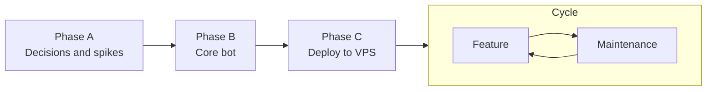

# Roadmap

Planned work, in order. `DECISIONS.md` overrules this file wherever they disagree. Phases are lettered (Phase A, Phase B, and so on) and match decision codes. A phase starts only when its decisions are Decided.

**Task format:** `- [ ] <task> (<codes>). Done when: <check>`

## Phase A: Decisions and spikes

**Goal:** settle what blocks Phase B.
**Exit:** every A and B row in `DECISIONS.md` is Decided.

- [x] Triage the Question rows A2, A3, A5, A6 (A2, A3, A5, A6). Done when: each row is Decided, TBD or Inspect.
- [x] Triage the Question rows B3–B8, B10, B11 (B3–B8, B10, B11). Done when: each row is Decided, TBD or Inspect.
- [ ] Spike: link a spare number, add it to a test group, and check which sender IDs arrive for the owner (B9). Done when: the finding is recorded in the B9 row.

## Phase B: Core bot

**Goal:** the bot answers `!$` prompts in groups and whitelisted DMs, using the group context.
**Exit:** in a real test group, `!$ what did X say earlier?` gets a correct answer that quotes the prompt, and a message without the prefix gets no reply.
**Out of scope:** media generation (B8), tools.

- [x] Rewrite the bot in Go with whatsmeow (A2, A6, A8). Done when: `go build ./...` and `go vet ./...` pass.
- [x] Pure router: decision, trigger, prompt, memory tags (B1, B3, B4, B7, B8, B9, B12). Done when: `go test ./internal/router` covers trigger and no-trigger, whitelisted and not, group and DM, prefix stripping, tag injection.
- [x] SQLite window and memories (B5, B11, B12, B16). Done when: a test shows the window is capped at 32 and persists across a restart, and memory search is per chat.
- [x] Claude clients: API key and CLI token (A5, A7, B6, B13). Done when: the CLI live test passes (`LLM_LIVE=1 go test ./internal/llm`).
- [ ] Link the spare number and record the user's LID in `WHITELIST` (B9, B10). Done when: a DM from the user gets a Claude reply, and a DM from another number gets the denial.
- [ ] Group membership rules (B15). Done when: a non-whitelisted adder → bot leaves; a whitelisted adder → bot stays.
- [ ] Live check in a test group (B1, B2, B9). Done when: the Phase B exit check passes.

## Phase C: Deploy to VPS

**Goal:** the bot runs unattended on the VPS.
**Exit:** the bot answers after a VPS reboot without any manual step.

- [x] Write the deploy steps (C2, C4). Done when: `deploy/deploy.sh kritz` builds, copies and installs the unit.
- [ ] Set up the process manager (C1). Done when: `sudo reboot` → the bot reconnects and answers a DM. (Unit installed and enabled; waits for `.env` and linking.)
- [x] Lock down secrets (C3). Done when: `.env` and `data/` are mode 600/700 and absent from git.

## Phase D: Persona and people

**Goal:** the bot has its own persona that only whitelisted users can change, and remembers people by LID across chats.
**Exit:** a whitelisted `!$ call yourself Rin and be sarcastic` changes the persona everywhere; the same request from a non-whitelisted member doesn't; a fact said about a person in one group is recalled about them in another chat.

- [x] Persona table with history, injected into the system prompt (D1). Done when: a store test shows set/get/history persists across a restart.
- [x] Persona updates honoured only for whitelisted requesters (D2). Done when: a router test parses the tag and main applies it only when the requester is whitelisted.
- [x] People profiles keyed by LID/number with handles (D3, D4). Done when: tests cover handle assignment, fact add/forget, global lookup across chats, and tag injection from chat text.
- [ ] Live check (D1-D4). Done when: the Phase D exit check passes.

## Phase E: Web access

**Goal:** the bot can search the web and read links people send.
**Exit:** `!$ what's the latest Go release?` gets a sourced, current answer, and a shared link gets summarised.

- [x] Server-side web tools in API mode, WebSearch/WebFetch in CLI mode, `pause_turn` handled (E1). Done when: `go test ./...` passes and the live web test passes.
- [x] Decide who may use the web (E2).
- [ ] Live check in WhatsApp (E1). Done when: the Phase E exit check passes.

## Phase G: OpenRouter provider

**Goal:** the bot can run on any OpenRouter model (DeepSeek V4.1 Flash first) while Claude stays available.
**Exit:** with `PROVIDER=openrouter` on kritz, a DM gets an in-character reply, `where am i from?` is answered via `search_facts`, and a web question gets a sourced answer.

- [x] OpenRouter client with `search_facts` loop, web server tools and image fallback; `PROVIDER`/`OPENROUTER_API_KEY` config (G1-G4). Done when: `go test ./...` passes with the fake-server tests.
- [x] Live OpenRouter test (G1-G4). Done when: `LLM_LIVE=1 go test ./internal/llm -run OpenRouter -v` passes with a real key.
- [ ] Live check in WhatsApp (G1). Done when: the Phase G exit check passes.

## Phase H: Self-updating knowledge

**Goal:** the people knowledge grows from everyday chat, not only from messages addressed to the bot.
**Exit:** after 16 ordinary group messages, the log shows a curator pass, and new facts or aliases appear for the people who talked.

- [x] Curator pass with unread tracking, idle timer, alias lookup and name-only merging (H1-H3). Done when: `go test ./...` passes and the live curator run extracts facts and aliases.
- [ ] Live check on kritz (H1). Done when: the Phase H exit check passes.

## Phase I: API and MCP tools

**Goal:** owners can have the bot read and act on any API, directly or through MCP servers.
**Exit:** a whitelisted DM with a Flow share link gets the task list; a configured MCP server's tool is used in a reply; a non-whitelisted requester gets `http_request` but no MCP tools.

- [x] Generic tool loop, `http_request` with public-only dialing, MCP client from `mcp.json` (I1-I3). Done when: `go test ./...` passes and the live Flow-link test lists the tasks.
- [ ] Live check in WhatsApp (I1, I2). Done when: the Phase I exit check passes.

## Phase J: Knowledge system v2

**Goal:** facts age, can be contradicted and carry their source; memory writes are validated tools; long chats keep their shape; changes are checked against a golden set.
**Exit:** an outdated fact is invalidated (not deleted) after a contradiction in chat; a hearsay claim ranks below the person's own statement and is shown as unverified; a reply never contains a memory tag; the golden set passes before deploy.

- [x] Golden set and runner (J6). Done when: the cases in J6 run on a cheap model with a cost report, and `deploy.sh` stops on a failure.
- [x] Fact schema v2 and migration (J1, J4). Done when: the 182 existing facts migrate with kind/tier, store tests cover invalidate, expiry of `state` facts and tier ranking, and search hides invalid facts.
- [x] Repetitive facts overwrite (J11). Done when: near-duplicate facts replace each other in place, aliases and higher tiers are safe, and no pair of the cleaned live facts counts as a duplicate.
- [x] Merge profiles of the same person (J12). Done when: a number-only profile merges when the LID appears, and name-only profiles merge only on a unique name match in a shared chat (store tests).
- [x] Memory tools replace tags (J3). Done when: replies and the curator use `save_fact`/`invalidate_fact`/`save_memory`, bad input returns an error to the model, CLI mode keeps tags, and no tag text can reach the chat.
- [x] Rolling chat summary (J8). Done when: the curator updates a capped per-chat summary and the prompt shows it.
- [ ] Scheduler (J7, after J9). Done when: a scheduled message is sent at its time through the pacer and survives a restart.
- [x] Research hybrid retrieval (J2). Done when: options are measured (size, RAM, latency, recall on the golden set) and presented.
- [x] Research token accounting (J5). Done when: counting options are measured and per-section budgets proposed.
- [x] Hybrid fact search (J2 b+c). Done when: a name in a global query ranks that person's facts by the rest of the query, facts get embedding vectors in the background, search unions embedding and FTS hits ordered by tier, and the paraphrase set recalls at least 22/24 in the top 10.
- [x] Learned token ratio and caps (J5 b+caps). Done when: the ratio updates from reported prompt tokens and survives restart, history lines and the request are capped, and trimming keeps the request and top 3 memories longest (router tests).

## Phase K: Grounded replies

**Goal:** Rin follows the standing preferences people set, and doesn't invent or defend claims about what was said.
**Exit:** an owner's `Prefers:` fact shapes every reply without a search; told she said something she didn't, Rin checks the transcript and takes it back.

- [x] Standing preferences in every prompt (K1). Done when: the requester's valid owner-tier `Prefers:`/`Rule:` facts (max 5) render under them in `<people>` in tool mode, and the golden case follows one (6/6 with it, 0/4 without).
- [x] Grounding rule for claims about the past (K2). Done when: the system prompt has the rule, and the golden case "corrects a false claim" passes (measured 4-5/8 with the rule, 0/8 without).
- [x] Current states in every prompt (K4). Done when: each person's newest 3 valid states render in `<people>` in tool mode (store and router tests), and the golden case "newer state from another chat beats a stale summary" passes (1/6 without, 5/6 with).

## Phase L: Owner commands

**Goal:** owners can manage the bot from WhatsApp without SSH or the model in the loop.
**Exit:** an owner's `/key` makes `http_request` use the key at once, and `/reset` gives a chat a fresh start, with neither message stored.

- [ ] Owner commands `/key` and `/reset` (L1, L2). Done when: unit tests cover parsing, key save/list/remove without echoing the secret, and reset keeping facts and memories; then, live, `/key` in a DM lets Rin read the owner's task board and `/reset` empties the chat context.
- [ ] Tagging people (L3). Done when: "@P2" in a reply becomes a WhatsApp mention and history stores "@Name" (router tests), the golden case "tags someone with a real mention" passes, and live, Rin tags someone in a group and they get notified.
- [ ] Cost log per reply (L4). Done when: the stats test passes, and live, `journalctl` shows a cost line for each reply.
- [ ] Group member awareness (L5). Done when: the golden case "tags a group member who hasn't spoken" passes, and live, Rin tags a group member who hasn't spoken since `/reset`.
- [ ] Reactions (L6). Done when: store tests cover set/change/remove/prune, the golden case "reads reactions on messages" passes, and live, a reaction on Rin's message shows up in her next reply's understanding.
- [ ] Bigger window and argument sides (L7, L8). Done when: the golden case "summary keeps who holds which side" passes, the full golden set still passes with the new prompt rules, and live, after a long group argument Rin states each person's side correctly.
- [ ] Older chat context on demand (L9). Done when: store tests cover the 72-hour retention (window kept, other chats excluded) and search, the golden case "looks up an older message with chat_history" passes, and live, Rin finds something said earlier the same day that has left the window.

## Phase M: Flood control

**Goal:** one person (or a crowd) can't run up the model bill; owners can silence someone without the model.
**Exit:** a flood is cut off after about 10 messages in 2 minutes, with no model calls for the flooder after that, and spend never passes $2 a day for non-owners.

- [ ] Flood timeout (M1). Done when: flood tracker tests cover trip, re-arm and window; the golden cases "flood check says SPAM for a flood" and "flood check says OK for fast chat" pass; and live, a burst of 10+ junk messages gets one notice and no more replies for 5 minutes.
- [ ] `/mute` and `/unmute` (M2). Done when: command and store tests cover mute, timed mute, unmute and listing; and live, a muted member's @mentions get no reply and don't appear in Rin's transcript.
- [ ] Daily spend cap (M3). Done when: store tests cover spend per day, and live, the cost log shows a running daily total.

## Cycle: feature and maintenance

**Feature turn**
1. Add the idea as a Question row in `DECISIONS.md`. Triage it to TBD, Inspect or Decided.
2. When its rows are Decided, add tasks here under a new lettered phase, in the usual task format.
3. Build, verify, and tick each task only when its check passes.

**Maintenance turn** (monthly)
- [ ] whatsmeow and SDK upgraded; whatsmeow tracks WhatsApp protocol changes, so stale versions break (A2). Done when: `go get -u go.mau.fi/whatsmeow anthropic-sdk-go` + `go mod tidy`, `go test ./...` passes, redeploy, and the live DM check works.
- [ ] Bugs and incidents triaged (all). Done when: each has a task or a Decided won't-fix.
- [ ] Docs match reality (all). Done when: no Decided row contradicts the code or `ARCHITECTURE.md`.
- [ ] Stale rows closed or reopened (all). Done when: no TBD or Inspect row is older than one cycle.
